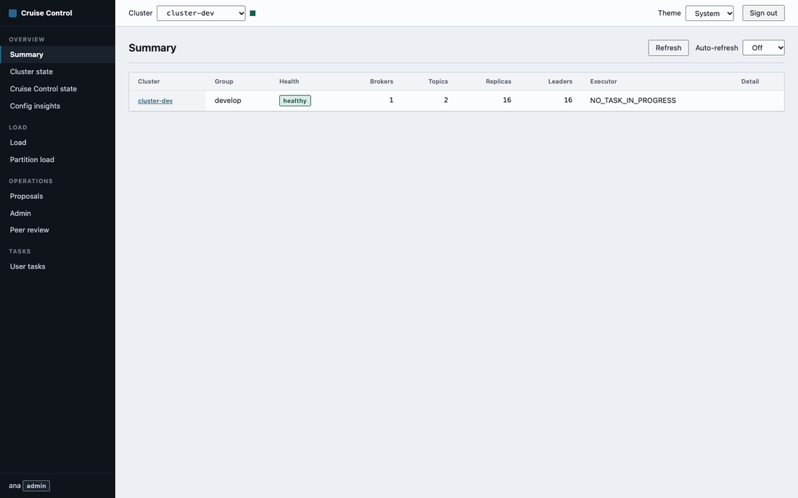

# kafka-cruise-control-ui

A web UI for [Cruise Control](https://github.com/cruise-control-for-kafka/cruise-control) `3.x`. One static Go binary serves an embedded single-page app and acts as an authenticated reverse proxy to one or more Cruise Control clusters. Documentation: https://devops-ia.github.io/kafka-cruise-control-ui/.

<p align="center">
  
</p>

The browser only talks to this server. Cruise Control credentials stay in the server's environment: they are never sent to the browser, never put in a URL or a request body, and never logged.

What you get:

- Pages for cluster state, broker and host load, partition load, Cruise Control state (executor, monitor, analyzer, anomaly detector), proposals, user tasks and a multi-cluster summary.
- An Admin page for rebalance, preferred leader election, add, remove and demote broker, fix offline replicas, topic replication factor, self-healing and concurrency, sampling and stop execution. Every operation has a separate "Simulate" (`dryrun=true`) and "Execute" (`dryrun=false`) button, and real executions ask for confirmation.
- A global panel for asynchronous operations (HTTP 202 and `User-Task-ID`) and a Peer review page for Cruise Control's two-step verification.
- Light and dark themes, keyboard navigation, tables you can sort and filter, auto-refresh.
- Login with a local admin or OIDC, roles (viewer, admin), CSRF protection, a strict Content-Security-Policy and an audit log of every POST.

## Quick start

```sh
docker run --rm -p 8080:8080 \
  -e CCUI_AUTH_MODE=none \
  -e CCUI_CLUSTERS__0__NAME=local \
  -e CCUI_CLUSTERS__0__URL=http://host.docker.internal:9090/kafkacruisecontrol \
  ghcr.io/devops-ia/kafka-cruise-control-ui
```

Open <http://localhost:8080>. `CCUI_AUTH_MODE=none` gives every visitor the admin role and logs a warning at start. Use it only on a laptop. The default mode is `local`, which refuses to start until you set a password hash and a session secret (see [Authentication](#authentication)).

The image runs as a non-root user, works with `--read-only`, is built `FROM` distroless and declares a healthcheck. `GET /healthz` and `GET /readyz` answer without authentication and expose no configuration.

## Configuration

Everything is configured with environment variables. The server validates all of them at start and exits with a message that names the variable when one is wrong. Unknown `CCUI_*` variables are rejected too, so a typo does not silently turn a security setting off.

Secrets (passwords, tokens, client secrets, the session secret) have no default. Each one can be given directly (`NAME`) or as the path of a file (`NAME_FILE`, trailing newline removed), which is how Kubernetes and Docker secrets are mounted. Secret values are never written to the log.

### Server

| Variable | Required | Default | Example |
| --- | --- | --- | --- |
| `CCUI_AUTH_MODE` | no | `local` | `none`, `local` or `oidc` |
| `CCUI_LISTEN` | no | `:8080` | `127.0.0.1:8080` |
| `CCUI_TLS_CERT` | no | none | `/tls/tls.crt` (set together with `CCUI_TLS_KEY`) |
| `CCUI_TLS_KEY` | no | none | `/tls/tls.key` |
| `CCUI_PUBLIC_URL` | with `oidc` | none | `https://cc.example.com`, the origin users type in the browser |
| `CCUI_LOGO_URL` | no | built-in mark | `https://cdn.example.com/logo.svg`, the sidebar icon and favicon |
| `CCUI_SESSION_SECRET` | with `local` and `oidc` | none | 32 or more random characters, see `_FILE` below |
| `CCUI_SESSION_IDLE_TIMEOUT` | no | `30m` | `15m` |
| `CCUI_SESSION_MAX_AGE` | no | `12h` | `8h` |
| `CCUI_COOKIE_INSECURE` | no | `false` | `true` only for plain-HTTP development |
| `CCUI_LOGIN_MAX_ATTEMPTS` | no | `5` | `10` |
| `CCUI_LOGIN_WINDOW` | no | `15m` | `10m` |
| `CCUI_TRUST_XFF` | no | `false` | `true` behind a reverse proxy that appends the client address |
| `CCUI_MAX_BODY_BYTES` | no | `1048576` | `65536` |

### Local users (`CCUI_AUTH_MODE=local`)

Define one or more users with consecutive indexes from 0, or only the admin shortcut. At least one user is required. Names must be unique, also against the shortcut and against OIDC user names.

| Variable | Required | Default | Example |
| --- | --- | --- | --- |
| `CCUI_LOCAL_USERS__<n>__NAME` | yes, per user | none | `ana` |
| `CCUI_LOCAL_USERS__<n>__PASSWORD_HASH` | yes, per user | none | a bcrypt or argon2id hash; plain text is rejected |
| `CCUI_LOCAL_USERS__<n>__ROLE` | yes, per user | none | `viewer` or `admin` |
| `CCUI_LOCAL_ADMIN_USER` | no | `admin` | `ops` |
| `CCUI_LOCAL_ADMIN_PASSWORD_HASH` | no | none | shortcut for one admin user |

### Clusters

Clusters are numbered from 0 with no gaps. `<n>` is the index.

| Variable | Required | Default | Example |
| --- | --- | --- | --- |
| `CCUI_CLUSTERS__<n>__NAME` | yes | none | `prod-eu`, letters, digits, `.`, `_`, `-`; unique |
| `CCUI_CLUSTERS__<n>__URL` | yes | none | `http://cc.kafka:9090/kafkacruisecontrol` |
| `CCUI_CLUSTERS__<n>__GROUP` | no | none | `prod`, groups clusters in the selector |
| `CCUI_CLUSTERS__<n>__TIMEOUT` | no | `60s` | `120s`, per request |
| `CCUI_CLUSTERS__<n>__AUTH_TYPE` | no | `none` | `none`, `basic`, `bearer`, `sigv4` or `oidc` |
| `CCUI_CLUSTERS__<n>__AUTH_USER` | with `basic` | none | `svc-ccui` |
| `CCUI_CLUSTERS__<n>__AUTH_PASSWORD` | with `basic` | none | |
| `CCUI_CLUSTERS__<n>__AUTH_TOKEN` | with `bearer` | none | |
| `CCUI_CLUSTERS__<n>__AUTH_SIGV4_REGION` | with `sigv4` | none | `eu-west-1` |
| `CCUI_CLUSTERS__<n>__AUTH_SIGV4_SERVICE` | no | `execute-api` | `execute-api` |
| `CCUI_CLUSTERS__<n>__AUTH_OIDC_TOKEN_URL` | with `oidc` | none | `https://auth.example.com/oauth2/token` |
| `CCUI_CLUSTERS__<n>__AUTH_OIDC_CLIENT_ID` | with `oidc` | none | |
| `CCUI_CLUSTERS__<n>__AUTH_OIDC_CLIENT_SECRET` | with `oidc` | none | |
| `CCUI_CLUSTERS__<n>__AUTH_OIDC_SCOPE` | no | none | `cruise-control/admin` |
| `CCUI_CLUSTERS__<n>__AUTH_FORWARD_IDENTITY` | no | none (off) | `jwt` or `doas` |

### OIDC login (`CCUI_AUTH_MODE=oidc`)

One or more providers, numbered from 0. Any OpenID Connect provider that publishes discovery metadata works (Microsoft Entra ID, Google, Amazon Cognito, Keycloak, Dex and similar). The login uses the authorization code flow with PKCE, `state` and `nonce`. The redirect URL to register at the provider is `<CCUI_PUBLIC_URL>/api/auth/<name>/callback`.

| Variable | Required | Default | Example |
| --- | --- | --- | --- |
| `CCUI_OIDC__<n>__NAME` | yes | none | `corp`, lowercase letters, digits and `-`; shown on the button |
| `CCUI_OIDC__<n>__ISSUER` | yes | none | `https://login.microsoftonline.com/<tenant>/v2.0` |
| `CCUI_OIDC__<n>__CLIENT_ID` | yes | none | |
| `CCUI_OIDC__<n>__CLIENT_SECRET` | yes | none | |
| `CCUI_OIDC__<n>__REDIRECT_URL` | no | `<CCUI_PUBLIC_URL>/api/auth/<name>/callback` | |
| `CCUI_OIDC__<n>__SCOPES` | no | `openid profile email` | `openid profile email groups` |
| `CCUI_OIDC__<n>__GROUPS_CLAIM` | no | `groups` | `roles` |
| `CCUI_OIDC__<n>__ADMIN_GROUPS` | no | none | `ccui-admins,platform` |
| `CCUI_OIDC__<n>__VIEWER_GROUPS` | no | none | `developers` |
| `CCUI_OIDC__<n>__DEFAULT_ROLE` | no | none (access denied) | `viewer` |

Every secret above also accepts the `_FILE` form, for example `CCUI_SESSION_SECRET_FILE`, `CCUI_LOCAL_ADMIN_PASSWORD_HASH_FILE`, `CCUI_LOCAL_USERS__0__PASSWORD_HASH_FILE`, `CCUI_CLUSTERS__0__AUTH_PASSWORD_FILE`, `CCUI_CLUSTERS__0__AUTH_TOKEN_FILE`, `CCUI_CLUSTERS__0__AUTH_OIDC_CLIENT_SECRET_FILE` and `CCUI_OIDC__0__CLIENT_SECRET_FILE`.

GitHub is an OAuth provider without OIDC discovery and is not supported directly. Put an OIDC broker such as Dex or Keycloak in front of it.

## Authentication

| Mode | What it does |
| --- | --- |
| `none` | No login. Everyone is `admin`. A warning is logged at start. |
| `local` | One admin account checked against a bcrypt or argon2id hash. |
| `oidc` | Users sign in at an OpenID Connect provider. Their role comes from a groups claim. |

Make a bcrypt hash for a local user (the leading `:` and the newline are removed):

```sh
htpasswd -bnBC 12 "" 'your password' | tr -d ':\n'
```

Example, one cluster with a local admin. The hash below is for a random password that nobody knows; replace it.

```env
CCUI_AUTH_MODE=local
CCUI_SESSION_SECRET=replace-with-at-least-32-random-characters
CCUI_LOCAL_ADMIN_PASSWORD_HASH=$2a$10$jDy/91QpAa9CaSz6CQ1YX.uzTI0uNvUjh0c6H2P.2w8Zqa1433ism
CCUI_CLUSTERS__0__NAME=prod
CCUI_CLUSTERS__0__URL=http://cc.kafka.svc:9090/kafkacruisecontrol
```

Sessions are kept in memory with a random 256-bit id in an `HttpOnly`, `Secure`, `SameSite=Lax` cookie. They end on logout, after the idle timeout and after the maximum age. They are lost when the process restarts, and with more than one replica you need session affinity at the ingress.

Failed logins are limited per client address and per user name. After `CCUI_LOGIN_MAX_ATTEMPTS` failures inside `CCUI_LOGIN_WINDOW` the login answers 429 with `Retry-After`, even for the right password. Behind a reverse proxy set `CCUI_TRUST_XFF=true`, otherwise every user shares the proxy's address.

State-changing requests need a CSRF token (from `GET /api/session`, sent as `X-CSRF-Token`) and an `Origin` equal to the server's own origin. Set `CCUI_PUBLIC_URL` when a proxy changes the `Host` header.

## Roles

| Role | Can |
| --- | --- |
| `viewer` | Overview and Load pages only: the endpoints `kafka_cluster_state`, `state`, `load`, `partition_load` and `permissions`. Anything else answers 403. |
| `admin` | Everything: proposals, user tasks, peer review, dry-runs, executions, `admin`, `review`, `topic_configuration`, pause and resume sampling, stop execution. |

Each local user has the role set in `CCUI_LOCAL_USERS__<n>__ROLE`; the `CCUI_LOCAL_ADMIN_*` shortcut and everyone in `none` mode are `admin`. With OIDC, `admin` wins over `viewer` when both group lists match; a user who matches none gets `DEFAULT_ROLE`, or is refused when it is not set.

## Talking to Cruise Control

The server calls only the Cruise Control 3.x endpoints it knows (the table lives in `internal/proxy/table.go` and a test compares it with Cruise Control's own endpoint definitions). The upstream URL comes only from the configuration, so a client cannot make the server call anything else. `json=true` is always added, `dryrun` must be explicit on POSTs, and parameters Cruise Control does not declare for an endpoint are rejected with 400. Nothing from the browser (cookies, `Authorization`, other headers) reaches Cruise Control, and `Set-Cookie`, `WWW-Authenticate` and `Location` from Cruise Control never reach the browser.

| `AUTH_TYPE` | Request to Cruise Control |
| --- | --- |
| `none` | no `Authorization` header |
| `basic` | `Authorization: Basic ...` |
| `bearer` | `Authorization: Bearer <token>` |
| `sigv4` | signed with AWS Signature V4 using the default AWS credential chain (environment, shared config, IRSA, instance role) |
| `oidc` | `Authorization: Bearer <token>` from the OAuth2 client-credentials grant, cached until it expires |

`AUTH_FORWARD_IDENTITY` is off by default. `jwt` sends the user's own OIDC id token as the Bearer token instead of the service credentials (it needs `CCUI_AUTH_MODE=oidc`). `doas` keeps the service credentials and adds `doAs=<user>`.

Cruise Control's own security must be on for per-user identities to mean anything. If the sampler setting of your Cruise Control leaves the load pages empty, check its metric sampler configuration; the UI only shows what Cruise Control reports.

Goals in the Admin forms are read from the analyzer state of the selected cluster. Cruise Control does not say which goals are hard, so the UI groups names containing `CapacityGoal`, `RackAware`, `BrokerSetAware` or `MinTopicLeadersPerBroker` as hard and everything else as soft. A goal the UI has never seen still appears, under soft.

### Two clusters

```env
CCUI_AUTH_MODE=none
CCUI_CLUSTERS__0__NAME=prod-eu
CCUI_CLUSTERS__0__GROUP=prod
CCUI_CLUSTERS__0__URL=http://cc-eu.kafka.svc:9090/kafkacruisecontrol
CCUI_CLUSTERS__0__AUTH_TYPE=basic
CCUI_CLUSTERS__0__AUTH_USER=ccui
CCUI_CLUSTERS__0__AUTH_PASSWORD=replace-me
CCUI_CLUSTERS__1__NAME=staging
CCUI_CLUSTERS__1__GROUP=dev
CCUI_CLUSTERS__1__URL=http://cc-staging.kafka.svc:9090/kafkacruisecontrol
CCUI_CLUSTERS__1__TIMEOUT=120s
```

## Security notes

- Responses carry a Content-Security-Policy with a per-response nonce and no `unsafe-inline`, `frame-ancestors 'none'`, `X-Frame-Options: DENY`, `X-Content-Type-Options: nosniff`, `Referrer-Policy` and `Permissions-Policy`. `Strict-Transport-Security` is sent only when this process serves TLS itself (`CCUI_TLS_CERT` and `CCUI_TLS_KEY`, TLS 1.2 or newer).
- Every POST to Cruise Control writes one JSON audit line to stdout with the user, role, cluster, endpoint, parameters and result status, also for refused attempts. Cookies, `Authorization` and tokens are never recorded.
- Request bodies are capped (`CCUI_MAX_BODY_BYTES`), every upstream call has a timeout, and a Cruise Control that is down or slow becomes a 502 or 504 with a generic message.

## Development

You need Go `1.26` or newer and `Node 22` or newer.

```sh
cd web && npm ci && npm run build && cd ..   # builds the SPA into web/dist, which the binary embeds
go test ./...
go vet ./...
CCUI_AUTH_MODE=none CCUI_CLUSTERS__0__NAME=local CCUI_CLUSTERS__0__URL=http://localhost:9090/kafkacruisecontrol go run ./cmd/server
```

For SPA work, `cd web && npm run dev` starts Vite on port 5173 and proxies `/api` to a server on port 8080. `npm run typecheck` and `npm test` run the type checks and the unit tests.

`docker build -t kafka-cruise-control-ui .` runs the same three stages as CI: Node builds the SPA, Go builds the binary with the SPA embedded, and the result is copied into a distroless non-root image. The sidebar shows `dev` as the version unless you pass one, for example `--build-arg VERSION=v1.4.0`; CI passes the release tag.

The frozen LinkedIn UI can still be built locally with `docker build --target legacy`; see [Legacy UI](docs/DEPLOYMENT.md#legacy-ui).

## License

See [LICENSE](LICENSE).
