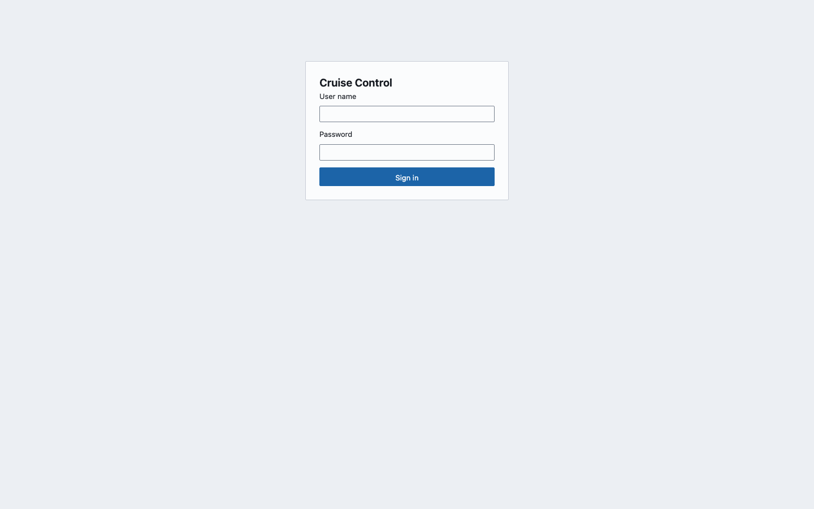
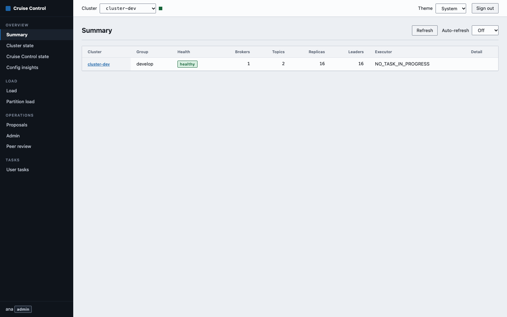
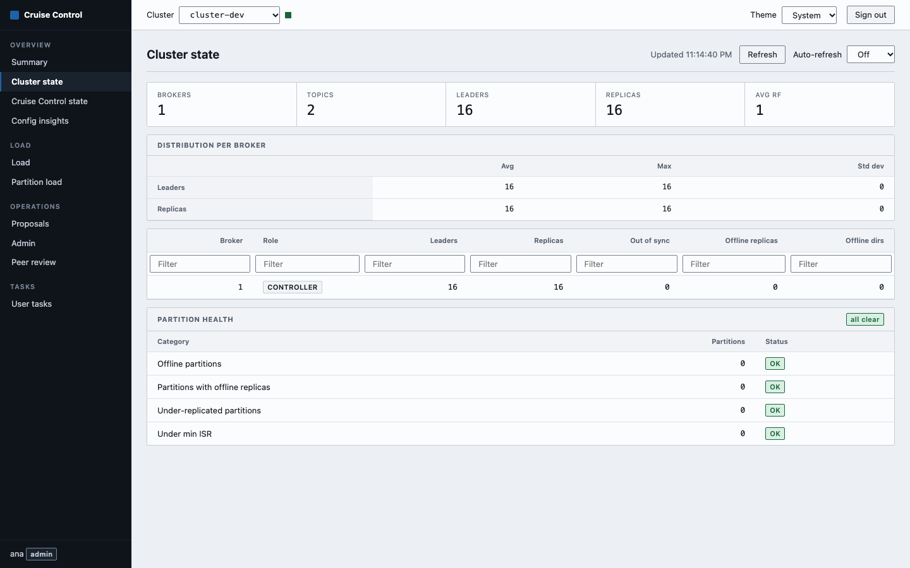
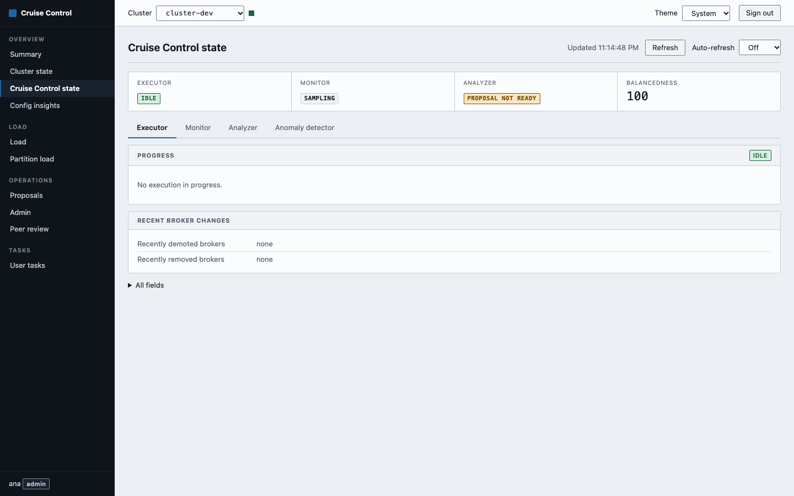
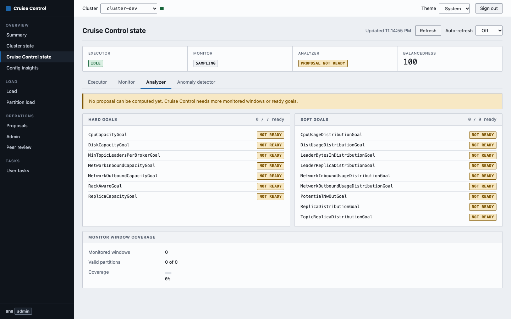
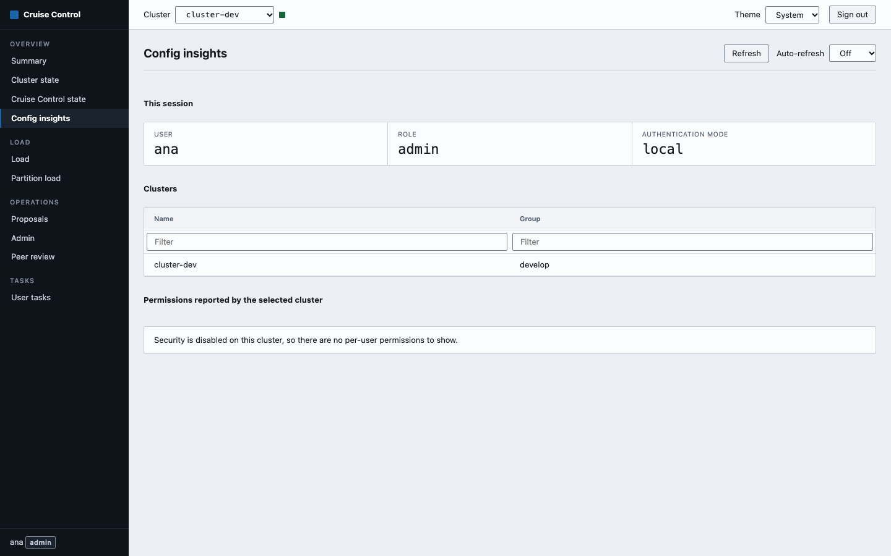
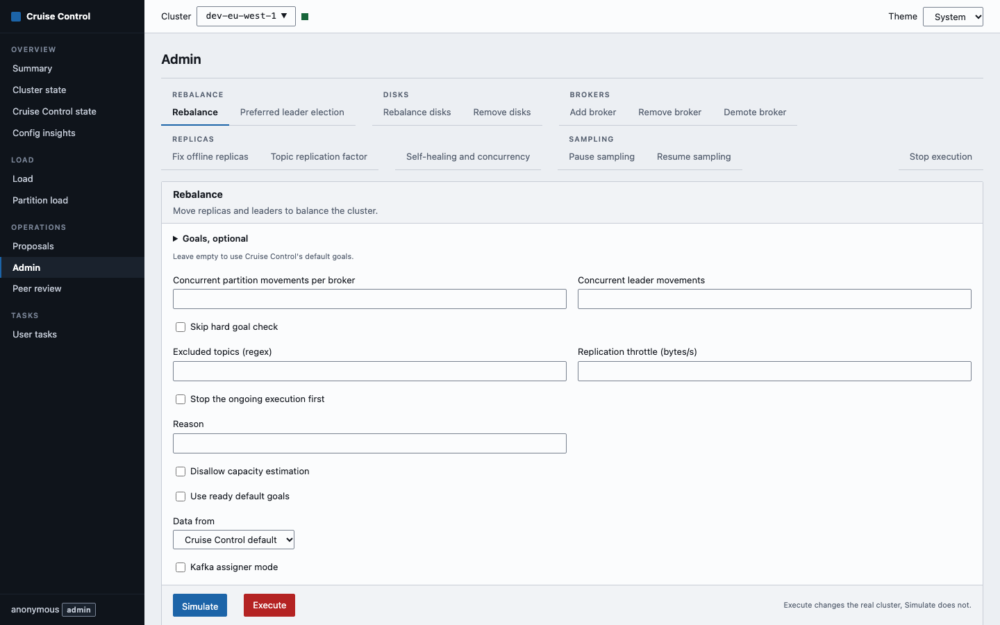
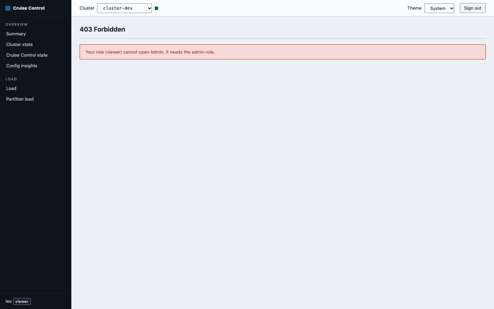

# User guide

## The layout

The left column lists the pages in four groups: Overview, Load, Operations and Tasks. The top bar has the cluster selector, the theme selector and, unless the server runs with `CCUI_AUTH_MODE=none`, a Sign out button. Your user name and role are at the bottom of the left column.

In `local` mode the login asks for a user name and a password. A wrong password gives "Wrong user name or password.", and once the attempt limit is reached it says "Too many failed attempts. Wait a few minutes and try again." In `oidc` mode it shows one "Sign in with `<provider>`" button per configured provider.

**Cluster selector.** Lists the clusters under their group. Every page works on the selected cluster, and the choice is remembered in the browser. The dot next to it is green when the cluster answered its last check (every 30 seconds), and a cluster that did not is marked "(unreachable)" in the list.

**Theme.** System, Light or Dark, also remembered in the browser.

**Auto-refresh.** Pages that load data have a Refresh button and an Auto-refresh selector: Off, 10 s, 30 s, 1 min or 5 min. The setting is shared by all pages and remembered. It is off by default. Auto-refresh counts as activity for the session idle timeout, so a page left open on auto-refresh never signs you out for being idle.

**Tables.** Click a column header to sort, click again to reverse. Most tables have a filter box under each header. Typing narrows the rows by that column.

## Summary

One row per cluster, for all clusters at once: group, health, brokers, topics, replicas, leaders and executor state. Health is "healthy", "N partitions at risk" (offline partitions, under-replicated partitions and partitions with offline replicas added together) or "unreachable", in which case the Detail column shows the error. Click a cluster name to select it and open its Cluster state.

## Cluster state

The cluster's Kafka state as Cruise Control reports it, from top to bottom:

- A row of totals: Brokers, Topics, Leaders, Replicas and the average replication factor.
- A "Distribution per broker" table with the average, maximum and standard deviation of leaders and replicas per broker. Any figure Cruise Control adds that the page does not know appears in an "Other" row.
- A Brokers table: id, whether it is the controller, leaders, replicas, out-of-sync replicas, offline replicas and offline log directories.
- Partition health: counts for offline partitions, partitions with offline replicas, under-replicated partitions and partitions under the minimum ISR. A category with partitions is marked DEGRADED and lists them below its row with leader, in-sync and out-of-sync brokers.

## Cruise Control state

The first row shows the executor, the monitor, the analyzer (proposal ready or not) and the balancedness score. Four tabs hold the detail. Each also has an "All fields" section with the raw values Cruise Control returned.

**Executor.** Whether a rebalance is running. While one is, you see partition and leadership movements as finished of total with a progress bar, the amount of data moved, the task that triggered it and its reason. The tab also lists recently demoted and removed brokers. When Cruise Control reports intra-broker movements, one table per non-empty list follows (for example "In progress intra-broker movements (2)", "Pending intra-broker movements (1)") with topic, partition and broker. Entries in the pending list that are already IN_PROGRESS appear under In progress.

**Monitor.** The load monitor: its state, whether the model is trained, monitored windows, valid and flawed partitions, and the coverage percentage. While the monitor state is LOADING, a "Loading progress" row with a bar shows how far it is.

**Analyzer.** Hard and soft goals, each marked READY or NOT READY. A note appears when no proposal can be computed yet, which usually means Cruise Control needs more monitored windows. Window coverage is repeated at the bottom.

**Anomaly detector.** For which anomaly types self-healing is enabled and disabled, the self-healing running now, and a table of recent goal violations, broker failures, metric anomalies, disk failures, topic anomalies and maintenance events. Each type shown under Enabled for or Disabled for carries its self-healing ratio as a percentage, and the panel lists the mean time to start a fix (in minutes), "Self-healing started" and "Self-healing failed to start" when Cruise Control reports them.

## Config insights

Shows what the browser may know about the setup and nothing more: your user name, role and authentication mode, the table of configured clusters (name and group) and the permissions Cruise Control reports for the selected cluster. When that Cruise Control runs without security the page says so instead of showing an error. It never shows a URL or a credential.

## Load

Load per broker or per host, switched with the tabs. Columns: host, rack, state, CPU, disk percentage, disk used, leader and follower network in, network out, replicas and leaders. All are sortable. "Populate disk info" (off by default) asks Cruise Control for per-disk data; when the brokers report it, a "Load by disk" table shows one row per broker and log dir with replicas, leaders, disk used and percentage (a dead disk shows DEAD). "Allow capacity estimation" is on by default; clear it to send `allow_capacity_estimation=false`. The options stay on screen while the page reloads.

## Partition load

The heaviest partitions for one resource. "Sort by" takes cpu, networkInbound, networkOutbound or disk, and "Rows" the number of partitions to fetch (1 to 5,000, 100 by default). "Topic (regex)" limits the list to matching topics; press Enter or leave the field to apply it. An empty field sends no filter, and the field stays visible when nothing matches.

## Proposals

Asks Cruise Control for the proposal it would make with its default goals, and shows replica movements, data to move, leader movements, intra-broker movements, the balancedness score before and after, a table of goals with a VIOLATED mark where one could not be met, and two blocks that come from the verbose answer. "Proposed partition movements (n)" is a table with topic, partition, old replicas and new replicas; it sorts, filters by topic, and marks removed and added replicas with colour, and also with hidden text ("removed", "added") for screen readers. "Load before and after by broker" (switch to "By host" with the tabs) shows each value before and after with the signed change, for example `80 → 70 -12.5%`; a broker that was not in the earlier load shows only its new value. When the brokers report per-disk data, a "Load by disk" table adds one row per broker and log dir (a dead disk shows DEAD). A block is left out when Cruise Control does not send its data. The "Intra-broker rebalance disk proposal" box asks again with `rebalance_disk=true`; it stays on screen and focused while the page reloads. Nothing is executed. This page needs the admin role.

## Admin

Each operation has its own tab. The form shows a title, a description, the parameters (required ones are marked `*`) and an actions bar. Leave a field empty to leave the parameter out. Use the left and right arrow keys, Home and End to move between tabs.

| Tab | Cruise Control endpoint | Notes |
| --- | --- | --- |
| Rebalance | `rebalance` | Goals, concurrency, excluded topics, replication throttle, reason, plus the common options below, Kafka assigner mode and destination broker IDs. |
| Preferred leader election | `rebalance` | Sends `goals=PreferredLeaderElectionGoal`. Moves leadership without moving data. |
| Rebalance disks | `rebalance` | Sends `rebalance_disk=true`. Moves replicas between the disks of a broker, with no goals. |
| Add broker | `add_broker` | Broker IDs are required. Common options and Kafka assigner mode. |
| Remove broker | `remove_broker` | Broker IDs are required. Common options, Kafka assigner mode and destination broker IDs. |
| Demote broker | `demote_broker` | Broker IDs are required. Replication throttle and Disallow capacity estimation. |
| Fix offline replicas | `fix_offline_replicas` | Common options. |
| Topic replication factor | `topic_configuration` | Topic (regex) and replication factor are required. Common options, skip rack awareness check, skip hard goal check, concurrency and replication throttle. |
| Remove disks | `remove_disks` | Pick the log dirs to empty (required), plus reason and "Stop the ongoing execution first". |
| Self-healing and concurrency | `admin` | Enable or disable self-healing for anomaly types, change concurrency, max partition movements in cluster, intra-broker concurrency and execution progress check interval. |
| Pause sampling | `pause_sampling` | |
| Resume sampling | `resume_sampling` | |
| Stop execution | `stop_proposal_execution` | Optional force stop. |

The common options are "Disallow capacity estimation", "Use ready default goals" and "Data from" (Cruise Control default, valid windows or valid partitions). "Disallow capacity estimation" sends `allow_capacity_estimation=false` when checked and nothing when not. Each option appears only on the operations whose Cruise Control endpoint accepts it. There is no `replication_logdir_throttle` field: Cruise Control does not implement it and the proxy refuses it.

Remove disks shows one group per broker with a checkbox for each online log dir, read from `kafka_cluster_state` (`OnlineLogDirsByBrokerId`). Your choice is sent as `brokerid_and_logdirs`, entries written `brokerId-logdir` and separated by commas, for example `0-/data/b,1-/data/a`. Cruise Control reads that list as comma separated, so a log dir whose path contains a comma is shown disabled with a note and cannot be selected. At least one log dir is required; with none checked, Simulate and Execute send nothing and say so. If the cluster does not report log dirs (it needs a Kafka version that does), the form says that and sends nothing. The Execute dialog lists the chosen log dirs. Like the other data-moving operations it does not send `verbose`.

The optional "Goals" section is a closed "Goals, optional" block with hard and soft goals side by side. The goals come from the analyzer state of the selected cluster. Leave all unchecked to use Cruise Control's default goals.

### Simulate and Execute

Operations that change data (everything from Rebalance to Topic replication factor, including Rebalance disks and Remove disks) have two buttons.

- **Simulate** sends `dryrun=true`. Cruise Control computes the result and changes nothing. Use it first.
- **Execute** sends `dryrun=false` after a confirmation dialog that names the operation and the cluster. It starts the real movement.

The dialog is the last stop. The page says "Execute changes the real cluster, Simulate does not."

Self-healing and concurrency, Pause sampling, Resume sampling and Stop execution have no dry run, so they show a single "Apply" button. It runs at once without a confirmation. Stop execution in particular acts immediately on the running rebalance.

## Peer review

Cruise Control can park every POST until another person approves it. That is its two-step verification, enabled with `two.step.verification.enabled=true` on the Cruise Control side.

When it is enabled, running an operation does not execute it. The task panel shows "waiting for review #N". The Peer review page lists the pending requests with their review ID, status, the request, who submitted it, when and why. Three buttons depending on the status:

- **Approve** for a PENDING_REVIEW request.
- **Execute** for an APPROVED request. It sends the original request again with its `review_id`.
- **Discard** for a pending or approved request.

When two-step verification is disabled, Cruise Control refuses `review_board` and the page says "Two-step verification is disabled on this cluster, so there is nothing to review" with the setting to change. That is not an error. The page needs the admin role.

The menu hides Peer review on a cluster where two-step verification is off. For an admin the UI asks Cruise Control once after sign-in and again each time you pick another cluster, so the entry follows the selected cluster without a reload. If that check fails (network error, 502, 504, 401 or any other answer), the entry stays visible. Opening `/review` by its address still shows the notice above; the hidden entry is a convenience and not an access control.

## User tasks

The list of tasks Cruise Control knows about: when they started, status, the request, the client and the User-Task-ID. Use it to find an operation that was started from another browser, or after you reloaded the page, which empties the task panel.

## The task panel

Operations that take time (HTTP 202 with a `User-Task-ID`) appear in an "Operations" panel in the corner, on every page, so you can keep navigating. Each entry shows the endpoint and cluster, a "dry run" mark, a state (running, done, error or waiting for review), the User-Task-ID and, while running, the latest progress step and percentage. It checks again every two seconds until Cruise Control finishes.

Done entries have "Show result", which expands the same result view as Proposals. Operations that return proposals send `verbose=true`, which is what makes the movement and load tables appear there. Entries that are not running have "Dismiss". The panel is kept in the browser's memory only: a reload clears it, but the task itself continues in Cruise Control and stays in User tasks.

## What a viewer sees

A viewer has no Proposals, Admin, Peer review or User tasks in the menu. The pages in Overview and Load work as for an admin, including Config insights. If a viewer opens an admin address directly, the page shows a "403 Forbidden" message ("Your role (viewer) cannot open Admin. It needs the admin role.") and sends no request to the server. A viewer never triggers the two-step check either, so the menu does not change. The server refuses those requests as well, so the menu is a convenience and not the control.

